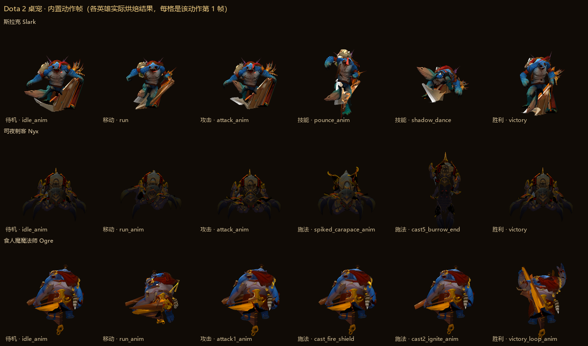

# Dota 2 桌宠（DSH 插件）

在你的 DeepSeek Harness 界面上养一只 Dota 2 英雄。动作不是贴图，是**从本机 Dota 2 的模型文件里读出来、离线烘成帧**的真实游戏动作（待机 / 跑动 / 攻击 / 突袭 / 黑暗契约 / 暗影之舞 / 死亡 / 胜利），再配好账号，让它按你最近常用的英雄出场。

## 安装

```sh
# 在你的 dsh profile 里（设置 → 插件 → 安装，或直接 pnpm add）
pnpm add dsh-dota2-pet
```

装好后在 profile 的 `package.json` 里把它加进 `dsh.profile.bundles`，重启 DSH 生效：

```json
{
  "dsh": { "profile": { "bundles": ["…", "dsh-dota2-pet"] } }
}
```

## 配置账号（必须，一次即可）

**设置 → DOTA2 桌宠 → 账号**，填你的**好友码（账号 ID）**或 **Steam64**，回车查询。不需要 API key。

能拿到：昵称、头像、段位（如"远古 IV"）、近 N 天胜负、最常玩的英雄（可一键让他上场当桌宠）。
数据源 [OpenDota](https://opendota.com)，由插件的宿主半代理请求并缓存 10 分钟。

> 段位取自 OpenDota 的 `rank_tier`；OpenDota 不提供精确天梯分，所以界面上不猜数字。

## 本机 Dota 2 检索

插件会按顺序找你的游戏目录：

1. 你在设置里手填的路径
2. Windows 注册表 `HKCU\Software\Valve\Steam\SteamPath`、`HKLM\...\Valve\Steam\InstallPath`
3. 常见 Steam 安装位置 × 全盘符
4. 每个 Steam 根目录的 `steamapps\libraryfolders.vdf` 与 `config\libraryfolders.vdf`
5. 全盘兜底扫 `steamapps\common\dota 2 beta`，并用 `appmanifest_570.acf` 交叉验证

判定标准只有一条：`pak01_dir.vpk` 真的能打开。找不到可以手填路径重试。检测结果与内置素材状态都能在设置页看到。

## 操作

| 操作 | 效果 |
|---|---|
| 左键拖动 | 移动位置（位置会记住） |
| 左键单击 | 随机做一个动作 + 说一句台词 |
| 右键 | 菜单：说句话 / **该英雄全部动作**（按分类列出）/ 放大缩小 / 贴到桌面 / 藏起来 |
| 滚轮 | 缩放 |
| 双击 | 收起桌宠 |

## 贴到桌面（Windows 增强）

DSH 插件本身只能渲染在 DSH 窗口内。Windows 上插件会额外拉起一个 **WPF 置顶、无边框、真透明、不进任务栏**的窗口（`powershell.exe`，系统自带，无需额外运行时），桌宠就真的浮在桌面上，DSH 最小化也还在。

入口：**设置 → DOTA2 桌宠 → 贴到桌面**，或右键菜单。

## 素材说明



包内自带**离线烘焙的动作帧**（3 个英雄共 786 帧，约 17 MB），所以没装 Dota 2 也能用：

| 英雄 | 动作 | 帧数 |
|---|---|---|
| 斯拉克 slark | 待机 / 跑动 / 攻击 / 突袭 / 黑暗契约 / 暗影之舞 / 死亡 / 胜利（8 个） | 256 |
| 司夜刺客 nyx_assassin | 待机 / 跑动 / 攻击 / 尖刺外壳 / 掘地出土 / 死亡 / 胜利（7 个） | 266 |
| 食人魔魔法师 ogre_magi | 待机 / 跑动 / 攻击 / 火焰护盾 / 引燃 / 死亡 / 胜利（7 个） | 264 |

每个动作烘两个朝向，帧率按游戏内动作时长反推，所以播出来的节奏和游戏里一致。加英雄只需再跑一次 `tools/bake`（[做法见这里](./tools/bake/README.md)），前端与桌面窗口的菜单会自动跟着变。

- 检测到本机 Dota 2 后，插件只读游戏文件、不复制、不落盘，后续版本会接入本机载入画面与英雄头像
- 动作与技能对应关系直接读自游戏：`ACT_DOTA_CAST_ABILITY_1` → 黑暗契约、`ACT_DOTA_SLARK_POUNCE` → 突袭、`ACT_DOTA_SHADOW_DANCE_STATUE` → 暗影之舞
- 素材体积想再小：把烘焙的 `--bake-size` 从 220 调到 180 左右即可（帧数不变、像素数约减半）

## 版本与发布

遵循[语义化版本](https://semver.org/lang/zh-CN/)；每个版本都在 [CHANGELOG.md](./CHANGELOG.md) 里写清"新增/修复/变更"，并打 `vX.Y.Z` 标签。

```sh
npm run check      # 语法检查（index.js / client.js / lib/find-dota.mjs）
npm test           # 离线冒烟测试，不需要 DSH 在跑、不需要装 Dota 2
git tag -a v0.1.1 -m "v0.1.1"
git push origin main --tags
npm publish        # prepublishOnly 会自动跑 check + test
```

CI（`.github/workflows/ci.yml`）在 Linux 与 Windows × Node 20/22 上跑同样的检查，另外校验：

- `package.json` 的 `dsh.bundle.patch` / `dsh.client` 是否有效、`files` 列出的路径是否都存在
- 内置动作帧的完整性（每个动作的帧数与 `manifest.json` 一一对应，缺帧直接失败）

想把插件上架 DSH 插件市场：往 [awesome-dsh-plugin](https://github.com/awesome-dsh-plugin/awesome-dsh-plugin) 提一个 PR 加一条目录（市场与 [dshmarket.com](https://dshmarket.com) 会自动收录，通常一天内生效）。

## 许可

MIT（见 [LICENSE](./LICENSE)）。Dota 2 及其素材版权归 Valve 所有；本插件只在你本机的游戏文件上做读取与渲染，不再分发游戏素材——仓库里的动作帧是由 `tools/bake` 在你本机游戏上离线渲染得到的。