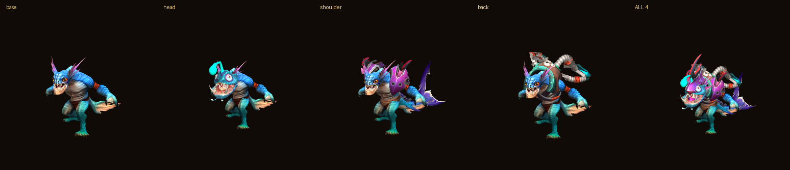

# 可研：给桌宠加 Dota 2 饰品 / 从创意工坊加载订阅内容

> 调研时间 2026-11-03～04。所有数字都是**本机实测**（Dota 2 在 `D:\SteamLibrary`，CLI 版本 20.1.7467），
> 不是估算。社区一手出处见文末。
>
> **一句话结论：饰品路线可行且已跑通；"从创意工坊加载订阅的饰品"这条路线不成立——Dota 2 的饰品根本不在创意工坊里。**

---

## 0. 结论速览

| 问题 | 结论 | 关键证据 |
|---|---|---|
| 能用 Dota 2 饰品模型给桌宠换装吗？ | ✅ **能，已实测跑通** | head/shoulder/back 三槽位饰品正确贴合，见 §5 |
| 能从创意工坊"加载订阅后的饰品"吗？ | ❌ **不能，前提不成立** | 本机 34 个 570 订阅项**全是攻略文本**，0 个模型；`AssociateWorkshopItems` 证明饰品走经济系统，见 §1 |
| 那 4.3 GB 的工坊订阅是什么？ | ⚠️ **Wallpaper Engine 壁纸（appid 431960），与 Dota 无关** | `appmanifest_431960.acf` 的 `"name"` 自证，见 §1.2 |
| 一个英雄全部饰品导出要多久？ | ⚡ **5.6 秒 / 87 件** | 批量导出，见 §3 |
| 挂点（attachment）能拿到吗？ | ⚠️ **glb 拿不到，必须走 vmdl 文本** | VRF 源码零引用 + 本机 MDAT 实测，见 §4 |
| 全部饰品预烘进插件？ | ❌ **11.7 GB，放弃** | 见 §2 规模测算 |
| 本地 CLI 有已知崩溃吗 | ⚠️ **有，需升级到 ≥20.1.7671** | 本机复现 issue #1411，见 §6 |


---

## 1. 决定性发现：Dota 2 饰品**不在**创意工坊里

这是整份可研的分岔点，所以先说它。

### 1.1 本机实测：34 个订阅项，一个模型都没有

`D:\SteamLibrary\steamapps\workshop\content\570\` 下有 34 个已订阅项，**全部是几 KB 的 `*_legacy.bin`，合计 191.6 KB**。
把文件头解出来，第一个 token 就是内容类型：

```
1187377550  "guidedata"   hero=dark_willow      鬼畜攻速大哥
 714815655  "guidedata"   hero=slark            GOX-迂回猎手，野战之王
 823898487  "guidedata"   hero=furion           GOX-三路带线，全场收割
 289214764  "HeroGuide"   hero=spectre          幽鬼加点攻略
 842006533  "HeroGuide"   hero=ember_spirit     7.06 法系火猫出装（附刷新球）.YYP
 ...
```

34/34 全是 `guidedata` / `HeroGuide`——**英雄攻略**，不是饰品。

### 1.1b acf 元数据（可直接照着写解析器）

`steamapps\workshop\appworkshop_570.acf` 是**纯文本 UTF-8 VDF/KeyValues**（首字节确认 `"AppWorkshop"\n{\n`），
任何 KV 解析器都能读，不需要 Steam 在线。本机实测结构：

```
"AppWorkshop" {
  "appid" "570"   "SizeOnDisk" "196195"          ← 全部订阅合计 191 KB
  "WorkshopItemsInstalled" {
    "289214764" { "size" "1565" "timeupdated" "1504224512" "manifest" "-1" "ugchandle" "847095706297819599" }
    ... }
  "WorkshopItemDetails" {
    "289214764" { "manifest" "-1" "subscribedby" "135700444" "latest_timeupdated" ... }
    ... } }
```

三条写解析器必须知道的约束：

1. **acf 在 `steamapps\workshop\` 下，不在 `steamapps\` 下**（与很多文档描述不同）。
2. **字段名有版本漂移**：本机的 key 是 `WorkshopItemsInstalled / size / timeupdated / manifest / ughchandle`；
   社区文档常见的 `InstalledItems / DeletedItems / VisibleChangeNumber / filename / filesize / tags`
   以及 `librarycache\` 目录**在本机都不存在** → 必须字段容错。
3. **acf 说"已装" ≠ 目录真存在**：社区仓库 [CS2-MapACFStateFix](https://github.com/Nyano1337/CS2-MapACFStateFix)
   就是专门修这个故障的 → 解析后必须 `Test-Path` 校验，以目录为准。
   （本机 `WorkshopItemsInstalled` + `WorkshopItemDetails` 两个 section 各 34 条 = 68 条，与 `content\570\` 的 34 个目录仍是 1:1。）

注意 570 每项的 `"manifest"` 全是 **`-1`**，而 Wallpaper Engine(431960) 每项是真实 64 位清单号——
这正好反映两者分发形态的差异（攻略文本 vs 完整 depot 清单）。


### 1.2 那 4.3 GB 的订阅池是 Wallpaper Engine，跟 Dota 无关（本文初稿标错过，已更正）

`content\431960\` 有 66 项、4.3 GB，我一度按"社区常识"把它当成 Dota 2 Workshop Tools DLC。
**本机自证否掉了这个假设**：

```
D:\SteamLibrary\steamapps\appmanifest_431960.acf
  "appid"       "431960"
  "name"        "Wallpaper Engine"
  "installdir"  "wallpaper_engine"
```

订阅项内容也是 Wallpaper Engine 的形态，不是 Source 2 资源：

| 扩展名 | 数量 | 是什么 |
|---|---|---|
| `.jpg` `.gif` `.png` `.mp4` `.webm` | 404 | 壁纸预览图与视频 |
| `.dxs` | 132 | **编译后的 HLSL 着色器**（头 `SHDV0069` + `DXBC`），在 `blobsSM40\` 下 |
| `.pkg` | 43 | Wallpaper Engine 私有 **`PKG V002` 场景包**（`scene.pkg`），**VRF 打不开** |
| `.json` | 66 | `project.json`，WE 的 schema（`"type":"scene"`、`"tags":["Anime"]`、`"title":"Zoro (Black and White)"`） |

**`.vpk` / `.vmdl` 数量：0。** 而且本机**没有安装 Dota 2 Workshop Tools**——
`steamapps` 下只有 4 个 appmanifest：`570 = Dota 2`、`431960 = Wallpaper Engine`、
`2384580 = DYNASTY WARRIORS: ORIGINS`、`228980 = Steamworks Common Redistributables`。

> **教训（写进流程）**：任何 appid 都必须用本机 `appmanifest_<id>.acf` 的 `"name"` 字段自证，
> 不能凭"社区常识/记忆"贴标签。Workshop Tools 的真实 appid 本次**未取到**（商店 API 被拦），不猜。
>
> 顺带一个可能有用的发现：这 66 项壁纸订阅里 `preview.jpg` / `.mp4` / `.webm` 是现成的桌面视觉素材，
> 与桌宠的"桌面背景层"需求契合——但那是另一件事，本报告不展开。


### 1.3 为什么：Dota 2 的工坊投稿走的是"审核 → 进官方 pak"这条路

社区与官方口径一致：**Dota 2 饰品由 Valve 采纳后直接打进游戏本体的 `pak01_dir.vpk`**，
工坊投稿系统只是**提交通道**，不是**分发通道**。所以：

- 你订阅攻略 → 本地有 `guidedata`（几 KB 文本）✅
- 你穿戴饰品 → 本地 `content\570\` 里**什么都不会多出来**，因为饰品模型早就在 `pak01_dir.vpk` 里了

**API 侧的决定性证据**（子代理从社区维护的 Steam Web API 目录取到，本机网络被拦未能在线调用）：

| 接口 | 参数/语义 | 说明什么 |
|---|---|---|
| `ISteamWorkshop/AssociateWorkshopItems`（publisher-only） | `publishedfileid[]` ↔ **`gameitemid[]`** + `revenuepercentage[]`（"工坊项所有者从该道具销售中获得的分成"） | 投稿被官方**转成游戏道具(gameitemid)后售卖**，分成给创作者 → "投稿走工坊、拥有走经济系统" |
| `IEconDOTA2_570/GetItemWorkshopPublishedFileIDs` | `itemdef` → published file ids | 这是**溯源/署名**接口（反查"这件饰品源自哪个工坊投稿"），不是分发接口 |
| `IPlayerService` 方法清单 | **不存在 `GetSubscribedItems`**，也没有任何工坊订阅方法 | 玩家侧根本没有"订阅饰品"这个概念 |

> **对桌宠的含义**：不需要、也不能"加载订阅后的饰品"。
> 正确做法是**从 `pak01_dir.vpk` 读全量饰品**（§2–§5），
> 再决定给这只桌宠穿哪套（§7 给了三个可选的"选哪套"数据源）。

### 1.4 顺带：读不到用户"拥有/穿戴"什么

`api.steampowered.com` 与 `steamcommunity.com` 在本机网络下**解析到非公网地址**（被拦），
本次无法实测任何端点。基于社区 API 目录（未在线验证）：

- `IEconItems_570` **只有两个方法**：`GetPlayerItems`（需 `steamid`）与 `GetStoreMetaData`（需 `language`）。
  **Dota 2 没有 `GetSchema`**（那是 440/730 那一类），所以"饰品名→图标/描述"得自己从 `items_game.txt` 取。
- **英雄穿戴（loadout / 套装）没有任何公开端点**——`IPlayerService` 里只有
  `GetProfileItemsEquipped` / `GetAvatarFrame` / `GetAnimatedAvatar` 这类**个人资料装扮**，与英雄饰品无关。
- 这些接口需要 **Steam Web API key**，且库存设为私密就拿不到。

所以"自动读取你身上穿的饰品"这条产品路径**当前不可行**，除非用户手填。见 §7。


---

## 2. 饰品在哪、有多少：规模测算（本机 VPK 全量索引）

`--vpk_dir` 扫 `pak01_dir.vpk` 得到 **388,170 个文件**（耗时 4.3 s），筛出：

| 类别 | 数量 | 中位 | 均值 | P90 | 合计 |
|---|---|---|---|---|---|
| 饰品模型 `models/items/*/*.vmdl_c` | **12,660** | 53 KB | 127 KB | 226 KB | 1,574 MB |
| 英雄模型 `models/heroes/*/*.vmdl_c` | 1,716 | 45 KB | 310 KB | 735 KB | 520 MB |
| 饰品贴图 `materials/models/items/*.vtex_c` | **50,699** | 88 KB | 210 KB | 344 KB | **10,381 MB** |

- 饰品按 **146 个英雄/主题目录**组织，最多的几个：`courier` 523（信使，非穿戴）、`drow` 305、`pudge` 276、`windrunner` 244。
- **合计约 11.7 GB**（未压缩、未计 glb 重编码）。

> 这直接否掉了"预烘全部饰品进插件"。README 里原先估的 0.7 GB 只算了模型、漏了贴图，
> 实际是它的 **16 倍**。GitHub 单文件 100 MB / 仓库 1 GB 的限制更是差两个数量级。
> **结论：饰品必须运行时从本机 VPK 读，且必须按需（per-hero）导出，不能全量。**

---

## 3. 性能：批量导出是唯一可行姿势

这是本次调研**最有工程价值**的一个数字。

| 做法 | 耗时 | 说明 |
|---|---|---|
| `--vpk_dir` 建全量索引 | 4.3 s | 一次性，可缓存 |
| **单件**导出（含材质贴图） | **2.5–3.2 s/件** | 几乎全是固定开销 |
| 同一文件重复导出 | 2.5–2.7 s | `--vpk_cache` **无效**（2.68s → 2.64s） |
| 进程空跑 `--version` | 0.05 s | 启动本身不慢 |
| **批量**导出 `models/items/slark/`（87 件 + 508 张贴图） | **5.6 s** | ✅ 一次进程扫索引、逐件写文件 |

**根因**：每次调用 VRF 都要重建 VPK 目录索引（≈2.4 s），与导出多少件几乎无关。
`--threads 4/8` 对 glTF **无效**——VRF 源码里 `GltfModelExporter` 明确不支持多线程导出：

```csharp
throw new InvalidOperationException($"{nameof(GltfModelExporter)} does not support multi threaded exporting, ...");
```

> **对桌宠的含义**：**一个英雄的全部饰品 = 一次批量调用 ≈ 6 秒**（含贴图）。
> 这个数字完全可以接受"用户换英雄时现导"，甚至"首次启动后台预导当前常用英雄"。
> 反过来，任何"逐件调用 CLI"的实现都会慢 40 倍（87 件 × 2.6s ≈ 3.8 分钟）。

产出实测：87 个 GLB / 6.9 MB（不含动画）～ 11.4 MB（含动画），508 张 PNG / 19.6 MB。
单件饰品 1,100–3,500 顶点，材质完整带 **baseColor + 法线 + 自发光 + ORM**，`alphaMode=MASK`（与既有笔记一致）。

---

## 4. 挂点（attachment）：glb 里没有，vmdl 里有

### 4.1 实测：饰品 GLB 是"无骨架的裸网格"

不加 `--gltf_export_animations` 时，导出的饰品 GLB：

```
nodes=1  meshes=1  skins=0  anims=0        ← 没有骨骼、没有蒙皮
```

VRF 的 glTF 导出器**完全不处理 attachment**——子代理读完 4 个 partial 源文件
（`GltfModelExporter.cs` / `.Skeleton.cs` / `.Mesh.cs` / `.Anim.cs`），**全文没有一处 "attachment"**；
官方 format-support 文档的 "glTF Export" 能力列表里也没有它。属于**静默丢弃**。

### 4.2 但挂点数据确实在游戏文件里

用 `-b MDAT` 直接读**本体** `models/heroes/slark/slark.vmdl_c`，挂点齐全：

```
m_attachments = [
  { key = "attach_attack1"  m_influenceNames = [ "wrist_R" ]  ... }
  { key = "attach_jaw"      m_influenceNames = [ "jaw6_0"  ]  ... }
  ...
]
```

斯拉克本体 10 个挂点 → 骨骼映射：

| 挂点 | 骨骼 | | 挂点 | 骨骼 |
|---|---|---|---|---|
| `attach_attack1` | `wrist_R` | | `attach_weapon` | `weapon_2` |
| `attach_attack2` | `wrist_L` | | `attach_blade` | `weapon_2` |
| `attach_hand_l` | `wrist_L` | | `attach_head` | `head` |
| `attach_head` | `head` | | `attach_jaw` | `jaw6_0` |
| `attach_eyeL/R` | `head` | | `attach_hitloc` | `chest` |

**饰品自己的 `m_attachments` 是特效挂点**（如 `attach_hose_01_fx` → `hose_mid_05_JNT`，给粒子用的），
不是"我该挂在本体哪里"——这个方向搞反过一次，值得记下来。

### 4.3 真正的钥匙：饰品骨骼与本体骨骼**同名**

加上 `--gltf_export_animations` 重导 back 饰品：

```
nodes=18  skins=1  anims=1
骨骼: backJig5_0, hose_top_01_JNT, hose_mid_01_JNT, ...
```

而本体 MDAT 的 96 根骨骼里**就有 `backJig5_0`**；head 饰品自带 `head`，本体也有 `head`。

> **这就是正确换装机制**：Dota 饰品不是"挂在挂点上"，而是**自带骨架、其中锚点骨骼与本体同名**，
> 蒙皮时直接把饰品顶点绑到本体同名骨骼上即可。
> 武器是例外——它没有对应骨骼，才需要 `attach_weapon → weapon_2` 这类显式映射
> （`render.py:167-176` 的注释和这个结论完全一致，说明之前的实现方向是对的）。

---

## 5. 端到端验证：真的穿上了

把第三方饰品（`models/items/slark/...`，非默认部件）用现有 `render.Model.merge_parts()` 装到本体上：

| 槽位 | 饰品 | 结果 |
|---|---|---|
| head | Angler in the Abyss - Head | ✅ 贴合 |
| head | katz_slark_head | ✅ 贴合 |
| shoulder | Shadow in the Deep Armor | ✅ 贴合 |
| back | Apparatus of Tellurian Trespass | ✅ 贴合 |
| 4 件同时 | — | ✅ 12,654 顶点，正常 |



**一个踩坑记录**（重要，避免重复排查）：第一轮测试时 back 饰品**漂浮在体外**，
原因不是管线缺陷，而是我**手动给它加了 `attach={'back':'weapon_2'}`**，把它当成武器绑到右手骨骼上了。
去掉错误的 attach 映射、走默认的最近邻权重传递后立刻正常。

> 规则：**只有武器类需要显式 attach 映射**；head/shoulder/back/arms 一律走权重传递，
> 不要按槽名去猜挂点。

---

## 6. 风险清单

| # | 风险 | 严重度 | 实测/依据 | 处置 |
|---|---|---|---|---|
| R1 | **本地 CLI 20.1.7467 在部分 Dota 饰品 + 动画时崩溃** | 🔴 高 | 本机复现 `crazy_experiment_back.vmdl_c`、`techies_mad_tex_arms.vmdl_c` → `IndexOutOfRangeException at CCompressedStaticFloat.Read`（issue **#1411**，2026-10-16 修复） | **升级到 ≥20.1.7671**；导出失败时**自动降级重试**（去掉 `--gltf_export_animations`） |
| R2 | 不带 `--gltf_export_animations` 会**连骨架一起剥离**（PR #822 行为） | 🔴 高 | §4.1 实测 `nodes=1 skins=0` | 导出饰品时**必须**带该开关；带骨架体积 +14%（6.9→11.4 MB / 英雄） |
| R3 | glTF 会把游戏**默认隐藏的 bodygroup 一起导出** | 🟡 中 | 官方文档明说（举例 CS2 `ctm_sas_variantf` 带第一人称手臂） | 用 `--gltf_mesh_list` 精挑；实测斯拉克饰品多为单 mesh，风险低 |
| R4 | 材质保真度：分层混合材质只导一层、cloth sheen 无等价物、只导最高 LOD | 🟡 中 | issues **#1161 / #576 / #535** | 桌宠尺寸小（220px），肉眼可接受；已在 v0.2.1/0.2.2 补了法线+高光+边缘光 |
| R5 | **CLI 参数无稳定性保证**（官方原文："We do not guarantee stability of the CLI interface"） | 🟡 中 | 官方文档 | 把 CLI 调用集中封装在一处，锁版本，升级跑对照 |
| R6 | 单个 `.glb` ≥2 GiB 直接抛 `NotSupportedException` | 🟢 低 | 源码 | 饰品都很小，不会触发 |
| R7 | 偶发材质加载失败 | 🟢 低 | 批量导出时报 `Failed to load ".../golden_hookblade_skadi.vmat_c"`，但 87 件全部产出成功 | 记录 + 跳过，不中断整批 |
| R8 | **Valve 素材不可再分发** | 🔴 高（合规） | 既有结论 | 保持现策略：**只读本机、不打包、不上传**；烘焙帧仅内置少量 |
| R9 | 无法读取用户穿戴（无公开 API + 本机网络拦截） | 🟡 中 | §1.4 | 改为"用户手选套装"，见 §7 |
| R10 | **前提性风险：appid 凭记忆贴标签导致整套方案空转** | 🔴 高（已发生） | 本文初稿把 431960 当成 Dota 2 Workshop Tools，实为 Wallpaper Engine（§1.2） | **任何 appid 都用本机 `appmanifest_<id>.acf` 的 `"name"` 自证**；未证实的 id 一律标"未取到"，不猜 |
| R11 | acf schema 版本漂移 / acf 与目录不一致 | 🟡 中 | §1.1b | 字段容错 + `Test-Path` 以目录为准；多库要遍历 `libraryfolders.vdf`（本机有 `C:\Program Files (x86)\Steam` 与 `D:\SteamLibrary` 两个库） |


---

## 7. 建议方案

### 7.1 数据源：三选一决定"给桌宠穿什么"

| 方案 | 数据源 | 可行性 | 体验 |
|---|---|---|---|
| **A. 套装下拉**（推荐） | `items_game.txt` 的 `item_sets`（本机实测：slark 11 套 / nyx 25 套 / ogre 11 套，每套 3–5 件） | ✅ 已具备（`wardrobe.py` 已实现） | 一键换整套，最省事 |
| B. 槽位自由搭配 | `items_game.txt` 的 `item_slot` + `used_by_heroes`（slark 78 件带模型） | ✅ 已具备（`itemlib.py`） | 可玩性高，UI 要做槽位面板 |
| C. 读取真实穿戴 | Steam 库存 API / loadout | ❌ 无公开 loadout API + 需 API key + 本机被拦 | — |

**建议 A 起步、B 作为进阶**，C 明确不做（但可在设置里留一个"手填饰品名"入口）。

### 7.2 运行时架构：per-hero 批量导出 + 本地缓存

```
用户切换英雄/套装
   ↓
[缓存命中?] ──是──> 直接渲染
   ↓否
一次 CLI 批量导出该英雄全部饰品（~6 s，87 件 + 贴图）
   -f "models/items/<hero>/"  --gltf_export_format glb
   --gltf_export_materials    --gltf_export_animations   ← 必须带，否则无骨架
   ↓
写入 %LOCALAPPDATA%\dsh-dota2-pet\cosmetics\<hero>\   （只读游戏、缓存在外，不打包进插件）
   ↓
merge_parts()：饰品顶点绑到本体**同名骨骼**；仅武器走 attach 映射
   ↓
烘焙动作帧（离线，一次性）
```

### 7.3 烘焙成本（实测，决定"能预烘多少"）

带 3 件饰品的斯拉克，`size=220`：**merge 0.46 s + 单帧 2.03 s** →
一个 30 帧动作 ≈ **61 s**；一个英雄 8 个动作 ≈ **8 分钟**。

- `size=180` 单帧 1.86 s，省 ~8%，收益有限 → **不要为了省时间降分辨率**，降帧数更有效。
- 因此**不要给"每套衣服"都预烘**（11 套 × 8 分钟 = 1.5 小时/英雄）。
  正确做法：**烘"本体 + 当前选中套装"的动作帧**，换装时只重烘，或
  走 §7.4 的实时路线彻底绕开烘焙。

### 7.4 中期建议：换掉 numpy 光栅化，改用 WebGL/three.js 实时渲染

现有纯 numpy 光栅化（1–3 fps）**只适合离线烘焙**，这是"换装必须重烘"的根源。
社区里 [timkurvers/dota2-model-viewer](https://github.com/timkurvers/dota2-model-viewer) 已经证明
"Node 宿主 + 浏览器 WebGL 渲染 glb"这条路走得通，而且**形态和 DSH 插件完全一致**（DSH 客户端本来就是浏览器）。

一旦切到 three.js 实时渲染：
- 换装 = 改一次材质/网格绑定，**毫秒级**，不需要烘焙
- 高光/边缘光/IBL 直接是引擎能力，不用自己补（v0.2.1/0.2.2 手工补的那三项全部作废）
- 插件体积不变（仍是运行时读本机）

**这是本项目最值得做的一次架构升级**，也是让"饰品"真正可用的前提。

### 7.5 明确不做

- ❌ 从创意工坊订阅项加载饰品（§1：不存在）
- ❌ 预烘/打包全部饰品（§2：11.7 GB + 合规）
- ❌ 读取用户真实穿戴（§1.4：无公开 API）
- ❌ 自研 VPK/vmdl 解析器（社区唯一成熟实现是 VRF，MIT；其余活跃库只有绑 Blender 的 SourceIO）

---

## 8. 落地工作量估计

| 阶段 | 内容 | 量级 |
|---|---|---|
| P1 | 升级 CLI 到 ≥20.1.7671；导出封装加"失败降级重试"（R1） | 小 |
| P2 | 导出加 `--gltf_export_animations`；`merge_parts` 支持**同名骨骼绑定**（§4.3） | 小 |
| P3 | per-hero 批量导出 + 本地缓存目录 + 进度提示（§7.2，约 6 s/英雄） | 中 |
| P4 | 设置页套装/槽位选择 UI（数据侧 `wardrobe.py` 已就绪） | 中 |
| P5 | 切 three.js 实时渲染，去掉烘焙依赖（§7.4） | **大，收益最高** |

---

## 9. 一手出处

**社区工具与源码**
- ValveResourceFormat / Source 2 Viewer（★2551，MIT，2026-11-03 仍在提交）https://github.com/ValveResourceFormat/ValveResourceFormat
- glTF 导出器（attachment 零引用）https://github.com/ValveResourceFormat/ValveResourceFormat/blob/master/ValveResourceFormat/IO/Gltf/GltfModelExporter.cs
- attachment 在 vmdl 反编译里的重建 https://github.com/ValveResourceFormat/ValveResourceFormat/blob/master/ValveResourceFormat/IO/Extract/ModelExtract.MeshLists.cs
- CLI 参数与用法 https://github.com/ValveResourceFormat/ValveResourceFormat/blob/master/docs/guides/command-line.md
- 格式支持/缺陷表 https://github.com/ValveResourceFormat/ValveResourceFormat/blob/master/docs/guides/format-support.md
- 模型导出指南（`models/items/` = Cosmetic items）https://github.com/ValveResourceFormat/ValveResourceFormat/blob/master/docs/guides/exporting-models.md
- SourceIO（Blender 插件，★984）https://github.com/REDxEYE/SourceIO ｜ ValvePak（★156）https://github.com/ValveResourceFormat/ValvePak
- dota2-model-viewer（Node+WebGL，形态最接近）https://github.com/timkurvers/dota2-model-viewer

**关键 issue / PR**
- #1411 Dota 饰品 + 动画导出崩溃（本机已复现）https://github.com/ValveResourceFormat/ValveResourceFormat/issues/1411
- #1156 glTF 骨骼过大遮挡模型 https://github.com/ValveResourceFormat/ValveResourceFormat/issues/1156
- #1161 分层混合材质只导一层 https://github.com/ValveResourceFormat/ValveResourceFormat/issues/1161
- #535 只导最高 LOD https://github.com/ValveResourceFormat/ValveResourceFormat/issues/535
- #576 cloth sheen 无 glTF 等价 https://github.com/ValveResourceFormat/ValveResourceFormat/issues/576
- #467 动画重复致体积爆炸（Dota `spectre_arcana_base` 1 GB → 75.5 MB）https://github.com/ValveResourceFormat/ValveResourceFormat/pull/467
- #1057 `@` 前缀废弃动画（既有笔记已记录）https://github.com/ValveResourceFormat/ValveResourceFormat/issues/1057

**Steam Web API（社区维护目录，本机网络被拦未在线验证）**
- `ISteamWorkshop`（`AssociateWorkshopItems` = pfid↔gameitemid+分成）https://steamapi.xpaw.me/ISteamWorkshop
- `IEconDOTA2_570`（`GetItemWorkshopPublishedFileIDs`、`GetItemCreators`；无 loadout）https://steamapi.xpaw.me/IEconDOTA2_570
- `IEconItems_570`（只有 `GetPlayerItems` / `GetStoreMetaData`，**无 GetSchema**）https://steamapi.xpaw.me/IEconItems_570
- `IPlayerService`（**无 GetSubscribedItems**；只有 `GetProfileItemsEquipped` 一类资料装扮）https://steamapi.xpaw.me/IPlayerService
- `IPublishedFileService`（pfid→标题/标签的正解，`key` required）https://steamapi.xpaw.me/IPublishedFileService
- acf 与目录会不一致的社区旁证 https://github.com/Nyano1337/CS2-MapACFStateFix

**本机代码**
- 饰品数据解析 [itemlib.py](../../dota2-3d/itemlib.py) ｜ 衣橱/套装 [wardrobe.py](../../dota2-3d/wardrobe.py) ｜ 装配与渲染 [render.py](../../dota2-3d/render.py)（`merge_parts` 的 attach 说明在 [:164-176](../../dota2-3d/render.py#L164-L176)）
- 前一篇社区调研 [research-source2-models.md](./research-source2-models.md)

> 注：`api.steampowered.com`、`steamcommunity.com`、`store.steampowered.com`、`developer.valvesoftware.com`
> 在本机网络下均不可达（解析到非公网地址），涉及 Steam 官方 API 的结论引自社区维护的 API 目录，未做在线验证。
> 本次**未取到**、因此不写进方案的：Dota 2 Workshop Tools 的真实 appid、Dota 2 工坊页分类清单、
> 图标 CDN（akamaihd / cloudflare）可用性、`addoninfo.txt` 语法与 `+mount_level`、dotaconstants 的 item icons 文件名。

